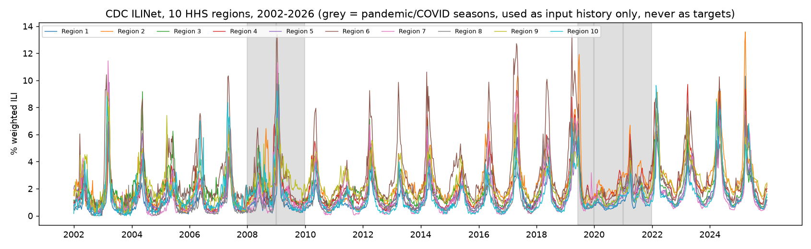
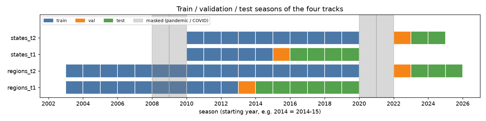
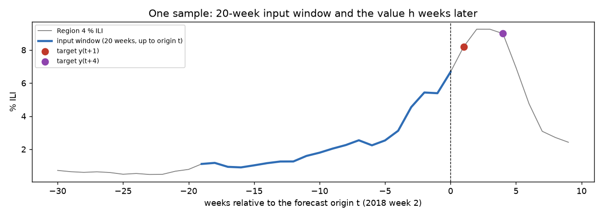
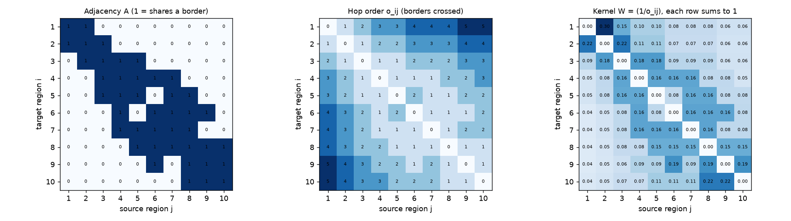
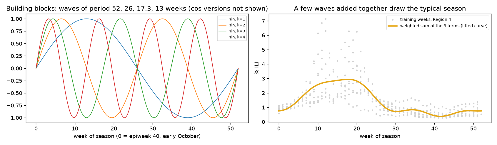
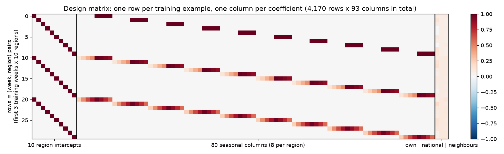
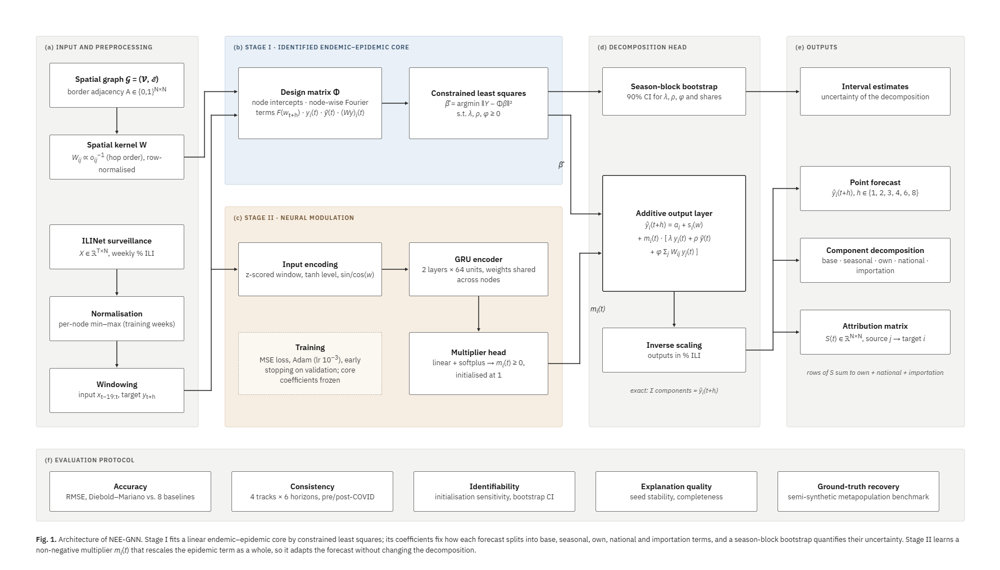
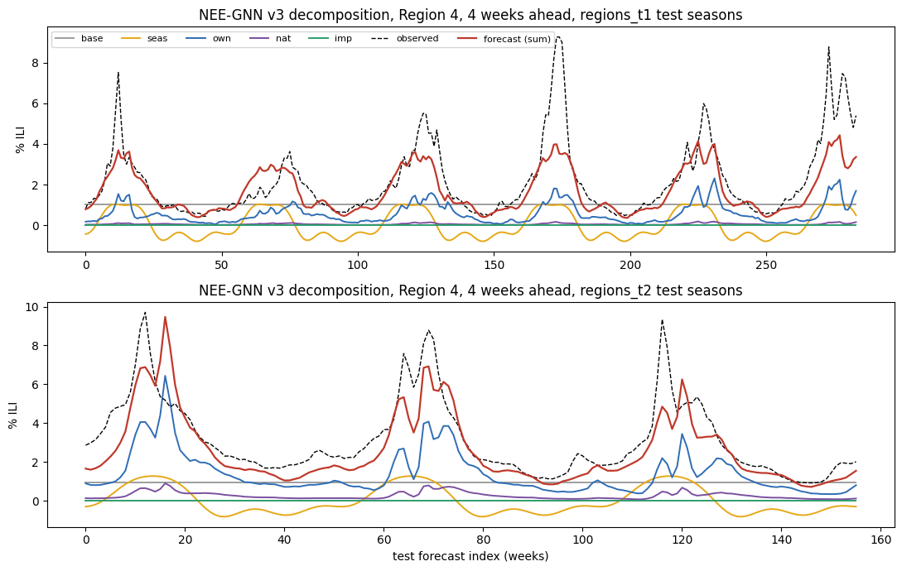
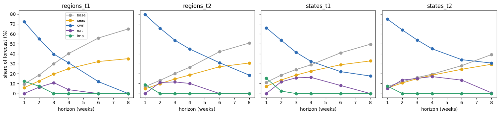

# NEE-GNN: the complete guide
### An identified neural endemic–epidemic model for explainable influenza forecasting (Team 18)

> **How to read this document.** It assumes you know basic machine learning (what training, a loss function and a neural network are) and nothing about epidemiology or this project. Read it in order: every section uses only ideas explained before it. Every number in it comes from our actual runs. Code references point to files in `code/`. Open this file in VS Code with **Ctrl+Shift+V** to see the figures.

**Contents**
1. The problem in one page
2. Background: the epidemiology you need
3. The data: what it is, how it is prepared, what it looks like afterwards
4. The method, built up step by step (with one real worked example)
5. The architecture diagram, box by box
6. Every design choice and why it was made
7. How we evaluate (baselines, metrics, statistics)
8. Accuracy results and what they mean
9. Explainability results and what they mean
10. The semi-synthetic benchmark (ground truth)
11. What is new, compared with existing work
12. Limitations (say them before anyone else does)
13. Questions you will be asked, with answers
14. Code and file map
15. Glossary

---

## 1. The problem in one page

**Goal.** Every week, forecast the level of flu-like illness in each US region (10 regions) and each US state (49 states), **1, 2, 3, 4, 6 and 8 weeks ahead**.

**Why it matters.** Hospitals, vaccine distribution and public alerts are planned weeks in advance. The US CDC runs a yearly forecasting challenge (FluSight) for exactly this.

**What already exists.**
- **Statistical models**, such as SARIMA and hhh4, are simple and interpretable but rigid.
- **Deep learning models**, especially **graph neural networks (GNNs)** such as Cola-GNN and EpiGNN, are flexible but are **black boxes**: they give a number and no reason for it.

**Our advisor's brief.**
- Use CDC surveillance data, plus only the static information that graph papers normally use.
- Build something **new** with an **advantage**.
- Accuracy should be **decent**, comparable to existing methods; better is a bonus.
- The advantage may come from **explainability**.
- Forecasting first, explainability after.

**Our answer: NEE-GNN.** It is a forecaster in which **every forecast is the exact sum of five named reasons**:

> forecast = **regional baseline** + **seasonal pattern** + **the region's own current activity** + **national activity** + **activity imported from other regions**

1. **The split into these five reasons is fixed by a statistical estimator with a unique solution** (so it is *identified*), and comes with confidence intervals.
2. **A small neural network adjusts the size of the epidemic part week by week**, without changing the split.

**What we showed.**
1. **Accuracy:** statistically indistinguishable from the best of 8 established baselines in 21 of 24 settings, and the most consistent model across the pre- and post-COVID periods.
2. **Explanations:**
   - identical across training runs;
   - on simulated epidemics where the truth is known, they track the true spread between states;
   - standard after-the-fact (post-hoc) explanations of a black-box GNN do not.
3. **Two honest findings:**
   - a shared seasonal wave can look like spread, for every method including ours;
   - spread between regions matters mainly one week ahead.

---

## 2. Background: the epidemiology you need

### 2.1 What is ILI and where does the data come from?
- **ILI (influenza-like illness):** a patient with fever ≥ 100 °F (37.8 °C) **and** cough and/or sore throat, without another known cause. It is a *symptom* definition, so no lab test is needed. That makes it fast and cheap, but it also catches other viruses.
- **ILINet:** the CDC's outpatient network. About 3,000 clinics report every week how many patients they saw in total and how many had ILI.
- **% ILI** = ILI visits ÷ all visits × 100. Typical values: about 1% in summer, 3–8% at a normal winter peak, above 10% in a bad season.
- **Weighted % ILI** (used for regions) weights each state by its population inside the region. **Unweighted % ILI** (used for states) is the raw ratio, the only version CDC publishes per state.
- **Region vs state:**
  - The 10 **HHS regions** are groups of states defined by the US Department of Health and Human Services. Region 4, for example, is the Southeast: Alabama, Florida, Georgia, Kentucky, Mississippi, North Carolina, South Carolina, Tennessee.
  - States are the 49 individual states we use.

### 2.2 Time units
- **Epiweek (MMWR week):** the CDC's numbered weeks, Sunday to Saturday. Some years have 53 of them.
- **Flu season:** from **epiweek 40** (early October) to week 39 of the next year. "Season 2017" means 2017-18.
- **Week of season (w):** 0 at epiweek 40, up to 51 or 52.
- **In-season weeks:** epiweek 40 to epiweek 20 (October to mid-May), when flu actually circulates. We score accuracy on these weeks, because summer weeks are near zero and easy to predict, which would flatter every model.

### 2.3 How flu behaves (the three facts our model is built on)
1. **Seasonality (the endemic part).** Flu returns every winter. The calendar alone gives a rough forecast: that is **climatology**, the average level for this week of the season.
2. **Persistence and momentum (the epidemic part, local).** Flu changes gradually. If a region is at 6% this week, next week is likely near 6%, and higher if it is rising. Statisticians call regressing a series on its own past **autoregression**.
3. **Spread (the epidemic part, spatial).** People travel, so infected people carry flu across borders. Activity in neighbouring places, or in the whole country, carries information about what comes next.

### 2.4 The endemic–epidemic model (hhh4): the idea we build on
Epidemiologists formalised these three facts in the **endemic–epidemic model**, known by its R function name **hhh4** (Held, Höhle & Hofmann 2005; Meyer & Held 2014). For weekly counts it says:

```
expected cases in region i this week =  ν_i(t)                           ← ENDEMIC: seasonal background
                                       + λ · cases_i(last week)           ← EPIDEMIC: within the region
                                       + φ · Σ_j w_ij · cases_j(last week) ← EPIDEMIC: from other regions
```

- **ν (endemic):** cases that appear "anyway". In practice it is modelled with sine and cosine waves of the week number, giving a seasonal curve.
- **λ (autoregressive coefficient):** how much of last week's level carries over.
- **φ (spatial coefficient)** and **w_ij (spatial weights):** how much other regions contribute. hhh4's standard choice is a **power law over neighbourhood order**: a region next door counts most, a neighbour's neighbour less, and so on.
- **How it is fitted:** by maximum likelihood with a count distribution (negative binomial).
- **Why people like it:** the expected value is a sum of meaningful parts, so it can be read directly ("70% of expected cases come from local transmission").
- **Its limitation:** it is linear with fixed coefficients, so it cannot adapt to the shape of a particular wave (fast rise, peak, decline).

**NEE-GNN = this structure, made fit for multi-week % ILI forecasting, plus a neural network that adapts it over time, while keeping the parts identified.** "NEE" stands for **N**eural **E**ndemic–**E**pidemic. "GNN" refers to the graph-based spatial term; see Q14 in section 13 for an honest discussion of that name.

---

## 3. The data

### 3.1 Sources
| File | Content | Period used |
|---|---|---|
| `ILINet_US_Regions.csv` (CDC FluView) | 10 HHS regions, weighted % ILI and counts | 2002 w40 → 2026 w38 (1,252 weeks) |
| `ILINet_US_States.csv` (CDC FluView) | all states, unweighted % ILI and counts | 2010 w40 → 2025 w39 (782 weeks) |
| Cola-GNN `region-adj.txt`, `state-adj.txt` | which regions/states share a land border (0/1 matrix) | static |
| Census 2010 population and population-weighted centroids | for the gravity variant and the simulator only | static |

**Verified:** our CDC download equals the counts in the benchmark files the GNN papers use. Cola-GNN's `region785.txt` matches 783 of 785 rows exactly; the other two differ by later CDC revisions. `state360.txt` matches all rows.



*Figure A: the raw series. Every winter has a wave; heights and timing vary; 2017-18 was very severe. Grey: pandemic (2009) and COVID (2020–22) seasons.*

### 3.2 Why 49 states (not 50 or 51)
- The standard benchmark we compare against (**Cola-GNN's US-States**, also used by EpiGNN and TERN) has **49 states: the 50 states minus Florida, without DC**.
- Florida is absent from that benchmark, most likely because its ILINet data were not public when the benchmark was built.
- We use exactly the same 49 states in the same order. This keeps the baselines on their published node set and their shipped border file, so our numbers are comparable with the literature. Florida and DC are complete in our download, so adding them is possible, but every baseline would have to be rerun on a new graph.
- Seven states have no data for 2025-26, so the States panel stops at 2024-25.
- Alaska and Hawaii have no land neighbours: no importation term for them.

### 3.3 Seasons we exclude as targets
The 2008-09 and 2009-10 seasons (H1N1 pandemic), 2020-21 and 2021-22 (COVID, when flu almost vanished), and 2019-20 after week 10 of 2020 (when COVID restrictions started) are **abnormal**.
- **They are never prediction targets**: not trained on, not scored. 239 Regions weeks and 134 States weeks are masked.
- **They remain readable as input history**, because a real forecaster in October 2022 would see them in its recent past. This follows the convention of the Flusion forecasting work.

### 3.4 The four "tracks" (train / validation / test splits)


| Track | Train seasons | Validation | Test seasons | Why |
|---|---|---|---|---|
| regions_t1 (main, pre-COVID) | 2003-04 → 2012-13 | 2013-14 | 2014-15 → 2019-20 (to 2020 w10) | the standard pre-COVID test period (as in EpiFNP) |
| regions_t2 (post-COVID) | 2003-04 → 2019-20 | 2022-23 | 2023-24 → 2025-26 | does the method survive the COVID regime shift? |
| states_t1 (pre-COVID) | 2010-11 → 2014-15 | 2015-16 | 2016-17 → 2019-20 | more nodes, so the graph can matter more |
| states_t2 (post-COVID) | 2010-11 → 2019-20 | 2022-23 | 2023-24, 2024-25 | as above, after COVID |

- **The split is chronological, by season:** the model only ever sees the past, as in real use. A random split would leak future information.
- **Validation is used only to stop training** (early stopping) and to choose between variants. It is never used to fit coefficients.
- **There is no separate calibration set**, because we produce point forecasts only.

### 3.5 Preprocessing, step by step
1. **Load and reshape** the CSV into a table **X** of size *T weeks × N nodes*; nodes are regions or states ([load_panel](../../code/nee_gnn.py#L108)).
2. **Flags per week:** season, week-of-season *w*, `valid` (allowed as target), `inseason` (scored).
3. **Per-node min–max scaling** using **training weeks only** ([scale](../../code/nee_gnn.py#L142), [scalers](../../code/nee_gnn.py#L151)):

   x_scaled = (x − min_train) / (max_train − min_train)

   - Each node then lives roughly in 0–1, so large and small regions are comparable.
   - Test values may exceed 1 when a test season is worse than any training season (e.g. Region 6 in January 2018: 1.107).
   - Every prediction is converted back to % ILI before scoring.
4. **Windowing** ([origins](../../code/nee_gnn.py#L137), [build_windows](../../code/nee_gnn.py#L158)). For each forecast origin *t* (the "now" week) and horizon *h*:
   - input = the last **20 weeks** up to and including *t*, all nodes;
   - target = the value at week *t + h*.

   A sample is kept only if its target week is valid and belongs to the track's train, validation or test seasons.
5. **Week-of-season features:** sin and cos of 2π·w/52 for every input week ([week_of_season_features](../../code/nee_gnn.py#L171)).



*Figure C: one sample. Blue = the 20-week input window ending at the origin (2018 week 2); red/purple = the value 1 and 4 weeks later that the model must predict.*

### 3.6 What the data look like after preprocessing
For one track and one horizon, the model receives three arrays per split:

| Array | Shape | Meaning |
|---|---|---|
| X | [n samples, 20 weeks, N nodes] | scaled input windows |
| Y | [n samples, N nodes] | scaled targets (value at t + h) |
| t | [n samples] | index of each origin week (to recover dates, week-of-season, in-season flag) |

Number of samples (origins):

| Track | Train | Validation | Test | Nodes |
|---|---|---|---|---|
| regions_t1 | 417 | 52 | 284 | 10 |
| regions_t2 | 753 | 52 | 156 | 10 |
| states_t1 | 241 (h=1) / 234 (h=8) | 52 | 179 | 49 |
| states_t2 | 472 (h=1) / 465 (h=8) | 52 | 104 | 49 |

Each sample covers all nodes, so regions_t1 has 417 × 10 = **4,170 (week, region) training examples**. That is small for deep learning, and it explains several design choices below.

**Raw → scaled example** (week 2 of 2018, all 10 regions):
```
raw % ILI : 2.86  5.89  3.77  6.67  4.71  11.51  6.72  2.62  4.76  4.24
scaled    : 0.43  0.91  0.40  0.93  0.47   1.11  0.59  0.39  0.51  0.48
```

---

## 4. The method, built up step by step

### 4.1 The full equation
For node *i*, forecast origin *t*, horizon *h*:

```
ŷ_i(t+h) =  a_i  +  s_i(w)  +  m_i(t) × [ λ·y_i(t)  +  ρ·ȳ(t)  +  φ·Σ_j W_ij·y_j(t) ]
            └── endemic ──┘               └───────────────── epidemic ─────────────────┘
            base   seasonal   multiplier     own         national       importation
```

| Symbol | Name | How it is obtained |
|---|---|---|
| y_i(t) | current activity of node i | **read from the data**: this week's (scaled) % ILI |
| ȳ(t) | national activity | **computed**: the plain mean of y over all nodes this week |
| Σ_j W_ij y_j(t) | neighbourhood activity | **computed**: a weighted average of the other nodes; weights W from the border map (section 4.3) |
| w | target week of season | **computed**: week-of-season of t + h |
| a_i | base (intercept) of node i | **learned** in Stage I |
| s_i(w) | seasonal curve of node i | **learned** in Stage I (8 Fourier coefficients per node, section 4.4) |
| λ, ρ, φ | own, national, importation coefficients (≥ 0) | **learned** in Stage I; one value each per track and horizon, shared by all nodes |
| m_i(t) | neural multiplier (≥ 0, starts at 1) | **produced by a GRU** from node i's last 20 weeks (Stage II) |
| ŷ_i(t+h) | the forecast | the sum |

The terms *outside* the bracket form the **endemic** part; those *inside* form the **epidemic** part, exactly as in hhh4.

### 4.2 A real worked example (every number is real)
**Setting:** Region 4 (Southeast); origin week 2 of 2018, during the severe 2017-18 season; horizon h = 1; track regions_t1. **What really happened next week: 8.19%.** "Persistence" (next week = this week) would say 6.67%.

**Step 1: current values** (scaled, from section 3.6):
- own y₄(t) = **0.932** (6.67% raw);
- national ȳ(t) = mean of the 10 scaled values = **0.622**;
- neighbourhood Σ W₄ⱼ yⱼ(t) = **0.612** (section 4.3 shows how).

**Step 2: learned coefficients** for this track and horizon:
- λ = **0.782**, ρ = **0.000**, φ = **0.129**;
- a₄ and Region 4's seasonal coefficients.

**Step 3: assemble the forecast** (statistical core, i.e. m = 1):

| Part | Calculation (scaled) | Converted to % ILI |
|---|---|---|
| base a₄ | 0.015 | 0.39 |
| seasonal s₄(w = 15) | 0.028 | 0.19 |
| own | 0.782 × 0.932 = 0.729 | **5.00** |
| national | 0.000 × 0.622 = 0 | 0.00 |
| importation | 0.129 × 0.612 = 0.079 | **0.54** |
| **forecast** | 0.851 | **6.12%** |

*(Conversion back: each part × Region 4's training range (7.14 − 0.28 = 6.85); the training minimum 0.28 is added to the base.)*

**The explanation that comes for free:**

> "Next week ≈ 6.12% = 0.39 (normal level) + 0.19 (time of year) + 5.00 (Region 4 is already high) + 0.54 (its neighbours, mainly Regions 3, 5, 6 and 7, are high)."

**Step 4: the neural multiplier.**
- The truth was 8.19%: the epidemic was **accelerating**, and a fixed linear formula cannot see acceleration.
- The GRU reads the last 20 weeks and can output m > 1 for a steep rise. For example, m = 1.37 would scale the epidemic part (5.00 + 0.54 = 5.54) to 7.61 and give exactly 8.19. (1.37 is the value that *would* be needed; it is not the trained model's actual output for that week.)
- Whatever m is, **own remains 90% and importation 10% of the epidemic part**: the multiplier changes the size, never the proportions.

### 4.3 The spatial kernel W: from a map to weights
1. **Borders (adjacency matrix A).**
   - A_ij = 1 if nodes i and j share a land border, else 0.
   - **We do not compute borders ourselves:** we use the matrices shipped with the Cola-GNN benchmark, the same ones every graph baseline uses.
   - Checked: symmetric; 16 border pairs for regions, 103 for states ([data checks, Cell 4](../../code/nee_gnn.py#L192)).
2. **Hop order o_ij:** the minimum number of borders crossed to go from j to i, by breadth-first search over A ([hop_order](../../code/nee_gnn.py#L334)). From Region 4:
   ```
   Region:    1  2  3  4  5  6  7  8  9  10
   hop order: 3  2  1  0  1  1  1  2  2  3
   ```
3. **Kernel:** W_ij = 1 / o_ij for j ≠ i, then each row is divided by its sum, so the weights of one row add up to 1 ([id_kernel](../../code/nee_gnn.py#L452)):
   ```
   W₄ⱼ:      0.054 0.081 0.162   0   0.162 0.162 0.162 0.081 0.081 0.054
   ```
   "Kernel" just means *the function that turns distance-on-the-map into a weight*.
   - Our kernel is the **power law** 1/o, the standard choice in hhh4 (Meyer & Held 2014).
   - Because rows sum to 1, Σ_j W_ij y_j is a **weighted average** of the other nodes, so φ is directly comparable to λ.
   - The **gravity** variant instead uses W_ij ∝ population_j^0.68 / distance_ij^0.95 (big, close places count more).



*Figure E: left, borders; middle, hop order; right, the kernel W (each row sums to 1).*

### 4.4 The seasonal curve s_i(w): drawing a season with waves
A flu season has a smooth yearly shape. Any smooth repeating shape can be written as a sum of a few sine and cosine waves (a **Fourier series**):

```
s_i(w) = Σ_{k=1..4} [ b_ik · sin(2πk·w/52) + c_ik · cos(2πk·w/52) ]
```

- k = 1 is one wave per year; k = 2, two per year; and so on. Four harmonics (8 numbers per node) are enough to draw a season with a peak and a long tail. More would start fitting noise.
- The model learns the 8 weights b_ik, c_ik per node ([fourier](../../code/nee_gnn.py#L370)).



*Figure D: left, the building-block waves; right, a weighted sum of them traces Region 4's typical season (grey dots = training weeks).*

**Important subtlety:** in our model, s_i(w) is not "the typical level" by itself. It is the seasonal **adjustment on top of** the other terms.
- At h = 1 the own term already carries the level, so s is small (+0.19 in the example).
- At h = 8 the own term drops to about 0 (section 9.2), so base + seasonal become the climatology itself.

### 4.5 Stage I: how the coefficients are learned (the design matrix)
We know the equation's *shape*. To find its *numbers*, we write every training example as one row of a table: the **design matrix** Φ ([core_design](../../code/nee_gnn.py#L464)).

```
                     | 10 intercept cols | 80 seasonal cols          | own    national  neighbours | target
row (week 1, R1)     | 1 0 0 0 0 0 0 0 0 0 | R1's 8 Fourier values, rest 0 | 0.12  0.10      0.11         | 0.14
row (week 1, R4)     | 0 0 0 1 0 0 0 0 0 0 | R4's 8 Fourier values, rest 0 | 0.007 0.073     0.073        | 0.079
...                  4,170 rows (417 weeks × 10 regions) × 93 columns
```

- **Rows** = training examples, one per (week, node).
- **Columns** = the ingredients of the equation:
  - a one-hot column per node gives each node its own intercept a_i;
  - Fourier columns, filled only in that node's block, give each node its own seasonal curve;
  - the three epidemic columns are own, national and neighbourhood activity.
- **The target column** = the value h weeks later.



*Figure F: the first 30 rows of the real design matrix. The staircase pattern is "each row activates only its own region's intercept and seasonal columns".*

**Constrained least squares** ([core_fit](../../code/nee_gnn.py#L473)) then finds the 93 numbers β that minimise ‖Y − Φβ‖² (squared error over all rows), subject to **λ, ρ, φ ≥ 0**. It uses SciPy's `lsq_linear`.
- This is ordinary linear regression with 93 inputs and three sign constraints. It is **convex**: one valley, no local minima, so there is **one best answer**. No random initialisation, no seed: rerun it and you get the same numbers.
- It uses training seasons only ([make_model](../../code/nee_gnn.py#L512)).
- It is fitted **separately for each track and horizon** (direct forecasting).

### 4.6 "Identified": the key concept
- **Identifiability** is a property of a model's parameters: the data determine them **uniquely**, so two different parameter values cannot explain the data equally well.
- **Why it matters for explanations:** if two different settings give the same forecasts but different parts (e.g. "70% own, 0% national" vs "35% own, 35% national"), the parts are arbitrary and so is the explanation.
- **This really happens.**
  - Own, national and neighbour activity all rise and fall together in winter (they are **collinear**).
  - When we let a neural network set λ, ρ and φ freely every week (our **unconstrained variant**), two training runs from different starting points were about equally accurate but explained the same forecasts differently.
  - For example, on pre-COVID States 4 weeks ahead: **seasonal share 5% in one run, 34% in the other**.
  - This is a known phenomenon in machine learning, called **underspecification** or the **Rashomon effect** (D'Amour et al. 2020).
- **NEE-GNN avoids it** because the split is fixed by the convex Stage I estimator. Two refinements matter:
  - **unique ≠ precise:** where collinearity is strong, the unique estimate can still be uncertain, so we attach confidence intervals (4.8);
  - **non-negativity** is what stops collinear terms from cancelling each other with opposite signs.

### 4.7 Stage II: the neural multiplier
The core is linear, so it cannot react to the *shape* of a wave. Stage II adds one adaptive number per node and week ([NEE3](../../code/nee_gnn.py#L483)):

1. **Input encoding** (4 numbers per week, 20 weeks; [lines 498–499](../../code/nee_gnn.py#L498)):
   - the window **z-scored** over time, (x − mean)/(sd + 0.05): the *shape* (rising, falling, peaking) independent of the level;
   - **tanh(x):** the level, squashed to stay bounded even if a test season exceeds the training range;
   - **sin and cos of the week of season:** where in the season we are.
2. **GRU encoder:** a 2-layer GRU with 64 hidden units reads the 20 weeks in order and summarises them in one vector. The same GRU, with shared weights, is used for every node. A **GRU** (gated recurrent unit) is a recurrent neural network with gates that decide what to remember and what to forget. It is smaller than an LSTM and works well on short sequences.
3. **Multiplier head:** a linear layer followed by **softplus** (a smooth, always-positive function) gives **m_i(t) ≥ 0**.
4. **Initialised at exactly 1** ([lines 492–493](../../code/nee_gnn.py#L492)): output weights 0 and bias log(e − 1), because softplus(log(e − 1)) = 1. So training **starts as the pure statistical core** and only learns corrections.
5. **Core coefficients frozen:** they are stored as buffers, not trainable parameters ([line 490](../../code/nee_gnn.py#L490)).
6. **Training** ([fit](../../code/nee_gnn.py#L554)):
   - loss = mean squared error; optimiser Adam (learning rate 0.001, weight decay 0.00001); batches of 32 samples;
   - at most 400 epochs, with **early stopping**: keep the epoch with the lowest validation error and stop after 40 epochs without improvement.

**Why a multiplier on the whole bracket?** m multiplies λ, ρ and φ by the same number, so the ratios between own, national and importation **cannot change**. The neural network can say "the epidemic part is stronger this week" (m > 1, e.g. a fast rise) or "weaker" (m < 1, e.g. at the peak). It can never say "now neighbours matter more than yourself". The base and seasonal parts are untouched.

### 4.8 Uncertainty: the season-block bootstrap
How sure are we about λ, ρ, φ and the resulting cross-region share? We use a bootstrap ([boot_core](../../code/nee_phase2.py#L793)):
1. Resample the **training seasons** with replacement. For example, from 10 seasons draw 10, so some appear twice and some not at all.
2. Refit Stage I on the resampled data.
3. Repeat 40 times. The 5th and 95th percentiles give a **90% interval**.

**Why whole seasons (blocks), not single weeks?** Weeks within a season are strongly correlated. Resampling single weeks would pretend we have far more independent information than we do, and give falsely narrow intervals.

### 4.9 Outputs
For every node, origin and horizon:
1. **Point forecast** in % ILI (clipped at 0).
2. **Five-part decomposition** in % ILI. The code **asserts** that the parts add up to the forecast and refuses to save a run otherwise ([run_one, lines 594–595](../../code/nee_gnn.py#L594)).
3. **Attribution matrix** S(t), N × N: how much of node i's forecast came from node j ([line 509](../../code/nee_gnn.py#L509)):
   - S_ij = m_i·(φ·W_ij + ρ/N)·y_j(t) for j ≠ i;
   - the diagonal holds the own part (plus i's own share of the national mean);
   - each row sums exactly to own + national + importation.
4. **Interval estimates** of the coefficients and of the cross-region share.

---

## 5. The architecture diagram, box by box



| Panel | Box | What it does | Section / code |
|---|---|---|---|
| (a) | Spatial graph | border adjacency A (benchmark file) | 4.3, [ADJ_REF](../../code/nee_gnn.py#L93) |
| (a) | Spatial kernel W | W ∝ 1/hop order, rows sum to 1 | 4.3, [id_kernel](../../code/nee_gnn.py#L452) |
| (a) | ILINet surveillance | T × N table of weekly % ILI | 3.1, [load_panel](../../code/nee_gnn.py#L108) |
| (a) | Normalisation | per-node min–max on training weeks | 3.5, [scale](../../code/nee_gnn.py#L142) |
| (a) | Windowing | 20-week input, target at t + h | 3.5, [build_windows](../../code/nee_gnn.py#L158) |
| (b) | Design matrix Φ | intercepts, node-wise Fourier, own, national, neighbours | 4.5, [core_design](../../code/nee_gnn.py#L464) |
| (b) | Constrained least squares | β = argmin ‖Y − Φβ‖² with λ, ρ, φ ≥ 0 | 4.5, [core_fit](../../code/nee_gnn.py#L473) |
| (c) | Input encoding | z-scored window, tanh level, sin/cos(w) | 4.7, [NEE3.forward](../../code/nee_gnn.py#L495) |
| (c) | GRU encoder | 2 layers × 64 units, shared across nodes | 4.7 |
| (c) | Multiplier head | linear + softplus → m ≥ 0, starts at 1 | 4.7 |
| (c) | Training | MSE, Adam, early stopping; core frozen | 4.7, [fit](../../code/nee_gnn.py#L554) |
| (d) | Season-block bootstrap | 90% intervals for λ, ρ, φ and shares | 4.8, [boot_core](../../code/nee_phase2.py#L793) |
| (d) | Additive output layer | the equation of 4.1 | [forward L503–510](../../code/nee_gnn.py#L503) |
| (d) | Inverse scaling | back to % ILI; check that the parts sum to the forecast | [run_one L594](../../code/nee_gnn.py#L594) |
| (e) | Outputs | forecast, decomposition, attribution matrix, intervals | 4.9 |
| (f) | Evaluation protocol | accuracy, consistency, identifiability, explanation quality, ground truth | sections 7–10 |

**The data flow in words:**
1. Data and graph go into Stage I once, which yields frozen coefficients β̂.
2. For every forecast, Stage II reads the recent window and yields m.
3. The output layer combines β̂, m and the current values into five parts, which sum to the forecast.
4. The bootstrap adds uncertainty to the parts.

---

## 6. Every design choice and why

### 6.1 Data and setup
| Choice | Why |
|---|---|
| CDC ILINet only (plus the static border map) | advisor's rule; it is the data every GNN paper on this benchmark uses, so comparisons are fair. Extra sources (weather, search data, genomics) were reviewed and rejected: weather's known gain is just seasonality (Shaman 2017), search data proved unreliable (Google Flu Trends), genomic data arrive too late |
| Regions and States | Regions (10 nodes) is the classic benchmark; States (49 nodes) is where a graph has more room to matter |
| Pre- and post-COVID tracks | COVID changed flu timing; testing both shows whether a method survives a regime shift. It became our key consistency finding |
| Masking pandemic and COVID seasons as targets | they are not normal flu seasons; training on them teaches the wrong pattern, scoring on them is meaningless |
| Chronological split by season | no information from the future leaks into training |
| One validation season | used only for early stopping and model selection; the literature standard |
| Horizons 1–4, 6, 8 | 1–4 weeks is the operational range (CDC FluSight); 6 and 8 test long range |
| 20-week window | the benchmark standard (Cola-GNN, EpiGNN), so the baselines run at their published setting |
| Min–max scaling per node, training weeks only | the benchmark standard; avoids leakage (test statistics never used) |
| In-season scoring (weeks 40–20) | off-season weeks are near zero and trivially predictable; including them hides differences. All-weeks scores were also computed for the baselines and the unconstrained variant and gave the same ranking |
| 49 states | identical to the benchmark (section 3.2) |

### 6.2 Model
| Choice | Why | Alternative considered |
|---|---|---|
| hhh4-style structure (endemic + own + spatial) | epidemiologically meaningful parts; a long track record in surveillance statistics | black-box GNN (no reasons); attention maps (shown to be unstable in our pilot P8 and in the literature) |
| **national term** ȳ | Thivierge et al. (2025, *Epidemics*) showed that the US average helps as much as neighbours; without it, national trends would be wrongly credited to neighbours | importation only |
| last week only (one lag) | hhh4's standard; keeps each term readable; the GRU sees the full 20 weeks anyway | several lags (more columns, more collinearity) |
| border graph, kernel 1/hop order | identical to the baselines' graph; power-law decay is hhh4's standard; earlier free-weight fits estimated the decay at about 1 (0.9–1.07) | gravity (kept as a variant), learned graph (not identifiable) |
| Fourier seasonal term, 4 harmonics | smooth, few parameters, standard in hhh4 | per-week dummies (52 per node, overfit) |
| **least squares** instead of hhh4's negative binomial likelihood | our target is a continuous percentage, not a count; we evaluate with RMSE, so squared loss matches the metric; convex with a unique solution | Poisson or negative binomial (needs counts) |
| **λ, ρ, φ ≥ 0** | infections cannot negatively cause infections; prevents collinear terms from cancelling | unconstrained (signs flip, meaningless parts) |
| one λ, ρ, φ shared by all nodes, per horizon | few data per node; sharing gives stable, interpretable numbers | per-node coefficients (noisy, wide intervals) |
| **direct** forecasting (one fit per h) | no error accumulation; the benchmark standard | recursive (feed predictions back in) |
| GRU (2 × 64) | small data (hundreds of weeks), so a small recurrent net; the same family as the baselines | LSTM (more parameters), Transformer (needs much more data) |
| **one multiplier on the whole epidemic part** | adapts the forecast while keeping the identified split | separate multipliers per term (brings non-identifiability back); additive neural correction (a new, unexplained part) |
| multiplier initialised at 1, core frozen | training starts from the statistical model; the neural part can only improve it | random start |
| z-score + tanh inputs | test seasons can exceed the training range (up to 3.65× on states_t1); raw inputs made an earlier model extrapolate badly | raw scaled values |
| 5 seeds | the neural part depends on random initialisation; 5 runs measure that variation (Stage I is deterministic) | 1–3 seeds |
| bootstrap by season, B = 40, 90% intervals | respects within-season correlation; 40 is enough for 5–95% percentiles at modest cost | week-level bootstrap (falsely narrow) |

**Hyperparameters vs learned parameters.**
- **Learned:** 93 numbers per track and horizon in Stage I (Regions; for States 49 + 392 + 3 = 444), plus about 38,000 GRU weights.
- **Chosen in advance:** everything in the tables above (window 20, K = 4, kernel, GRU size, learning rate 0.001, batch 32, max 400 epochs, patience 40, 5 seeds, B = 40).
- **None were tuned on test data.** Most are literature defaults. The baselines also run with their repository defaults, so the comparison is like-for-like.

---

## 7. How we evaluate

### 7.1 Baselines (8, all rerun by us on identical data)
| Model | Type | One-line description |
|---|---|---|
| AR | linear | regression of each node on its own past window |
| ARIMA | classical statistics | autoregressive integrated moving average, fitted per node |
| SARIMA | classical statistics | ARIMA plus a 52-week seasonal component; the strongest classical model before COVID |
| LSTM | deep learning | recurrent network over the multivariate window, no graph |
| GRU | deep learning | as LSTM, with a gated recurrent unit |
| CNNRNN-Res | deep learning | convolution + recurrent layers + residual link |
| Cola-GNN (CIKM 2020) | graph neural network | RNN plus learned cross-location attention over the graph |
| EpiGNN (ECML-PKDD 2022) | graph neural network | transmission-risk encoding, learned region graph, multi-scale temporal convolution |
| persistence (reference line) | naive | "h weeks later = this week" |

- **How the baselines were run:** through the authors' own code, behind a small adapter. Neural baselines use 3 seeds; ARIMA and SARIMA are deterministic.
- **Adapter validation:** on the original Cola-GNN data and split, our reruns reproduce the published numbers within about 1–4% for AR, LSTM, CNNRNN-Res and EpiGNN. Cola-GNN comes out 3–13% worse, because its paper tuned hyperparameters and we used defaults.
- **Code:** [baselines_all.py](../../code/baselines_all.py).

### 7.2 Metrics and statistics
- **RMSE** (root mean squared error) in % ILI, pooled over all nodes and in-season test weeks; lower is better. **PCC** and **MAE** are also computed.
- **Seeds:** we report the mean ± standard deviation over 5 seeds (ours) or 3 seeds (baselines). A **seed ensemble** averages the seeds' forecasts.
- **Diebold–Mariano (DM) test:** is the difference in squared error between two forecasters **statistically significant**? It accounts for the autocorrelation of forecast errors (Newey–West variance, Harvey–Leybourne–Newbold small-sample correction). p < 0.05 counts as significant. We compare our seed-averaged forecast with the best baseline's.
- **Consistency:** in each of the 24 settings (4 tracks × 6 horizons), the relative gap to the best baseline. Summarised as the **worst gap** and the number of settings within 5%.

---

## 8. Accuracy results

### 8.1 Main table: test RMSE (% ILI), NEE-GNN (5-seed mean) / best baseline
**\*** = DM test significant at p < 0.05.

| Track | h=1 | h=2 | h=3 | h=4 | h=6 | h=8 |
|---|---|---|---|---|---|---|
| Regions, pre-COVID | 0.575 / **0.517\*** SARIMA | 0.929 / 0.803 SARIMA | 1.172 / 1.026 SARIMA | 1.300 / 1.199 SARIMA | **1.461** / 1.473 SARIMA | **1.500** / 1.587 EpiGNN |
| Regions, post-COVID | 0.629 / 0.583 Cola | 0.988 / 0.980 EpiGNN | 1.249 / 1.201 EpiGNN | **1.266** / 1.285 EpiGNN | 1.498 / 1.453 EpiGNN | **1.586\*** / 1.768 EpiGNN |
| States, pre-COVID | 0.846 / 0.824 SARIMA | 1.229 / 1.159 SARIMA | 1.487 / 1.408 SARIMA | 1.658 / 1.603 SARIMA | 1.878 / 1.871 SARIMA | **1.980** / 2.004 SARIMA |
| States, post-COVID | 0.739 / **0.685\*** Cola | **1.129** / 1.147 Cola | **1.342** / 1.395 EpiGNN | **1.448** / 1.511 EpiGNN | **1.575** / 1.631 EpiGNN | **1.685** / 1.838 EpiGNN |

Persistence, for scale (h = 1 / 4 / 8):
- Regions pre-COVID: 0.573 / 1.442 / 2.182
- Regions post-COVID: 0.689 / 1.760 / 2.505
- States pre-COVID: 0.820 / 1.834 / 2.673
- States post-COVID: 0.762 / 1.852 / 2.667

**Reading the table:**
1. **21 of 24 settings: statistically indistinguishable from the best baseline.** One significant **win** (Regions post-COVID, 8 weeks, −10.3%) and two significant **losses**, both at 1 week ahead.
2. **NEE-GNN is lower than the best baseline in 10 of 24 settings**, mostly at long horizons and post-COVID.
3. **Seed ensembles:** ranked **1st of 9 models in 10 settings, top-2 in 19 of 24**.
4. **Why it loses at h = 1:** one week ahead, SARIMA and Cola-GNN capture very short-term dynamics well, and persistence is already strong. Every neural baseline is also near or above persistence there. Our single-lag linear core plus one multiplier is less sharp at the very short range.
5. **The model is far better than persistence at long range**, e.g. 1.500 vs 2.182 at 8 weeks on Regions pre-COVID.

### 8.2 Consistency: the main accuracy argument
Gap to the best baseline across all 24 settings:

| Model | Worst gap | Median gap | Settings within 5% of best |
|---|---|---|---|
| **NEE-GNN** | **15.7%** | **0.8%** | **16 / 24** |
| SARIMA | 23.2% | 0.2% | 15 / 24 |
| EpiGNN | 38.0% | 3.5% | 12 / 24 |
| Cola-GNN | 29.2% | 12.3% | 4 / 24 |
| GRU / LSTM | 28.1% / 26.7% | 16.0% / 15.6% | 1 / 0 |
| ARIMA / AR / CNNRNN-Res | 35.0% / 39.4% / 53.1% | 17–27% | 0–1 |

**Interpretation:**
- **Every baseline is good in only one regime.**
  - SARIMA is the best model **before** COVID: its fixed seasonal template fits the old timing. It fails after COVID, when the timing shifted.
  - EpiGNN and Cola-GNN are the best **after** COVID and weak before it.
- **NEE-GNN is never far from the best in either regime.** For a forecaster that will be used in an unknown future, that is the property that matters.

### 8.3 What the statistical core alone achieves (ablation)
Running Stage I only (m = 1 always, no neural network):
- it has the **smallest worst gap of all models, 9.9%** (18/24 within 5%);
- it has two significant losses at 1 week ahead and no significant wins.

**What this tells us:**
1. A well-specified endemic–epidemic model is **as good as modern deep GNNs on this benchmark**. This agrees with recent work showing seasonal references beat published GNNs on US-Regions (TERN 2026).
2. On the real data, the neural multiplier gives **small gains post-COVID** and on long horizons, but **slightly hurts pre-COVID Regions**. On pre-COVID States it does not move from its starting value (early stopping keeps m = 1), so it equals the core there.
3. On the **simulated** epidemics (section 10), whose dynamics are more nonlinear, the multiplier matters a lot: core alone RMSE 0.69–0.98 vs full model 0.46–0.56.

The honest summary: *the statistical core does most of the work on real flu data; the neural stage is a safe adaptive layer that helps when dynamics are nonlinear and never changes the explanation.*

### 8.4 The unconstrained variant (ablation)
The same five-part model with all weights set freely by the neural network:
- similar accuracy (2 significant losses, 1 win, worst gap 13.0%), slightly better on pre-COVID tracks;
- explanations **not identified** (sections 4.6 and 9.3).

We therefore **trade a little pre-COVID accuracy for trustworthy explanations**: a deliberate, documented choice.

In ablations of that variant, a **random graph with the same number of edges** and the **gravity** kernel were as accurate as the border graph, and removing importation cost nothing. The border structure adds little accuracy, consistent with the literature (Thivierge 2025; SpatialEpiBench 2026).

---

## 9. Explainability results

### 9.1 What the decomposition looks like


*Figure 3: 4-week-ahead forecasts for Region 4. Red = forecast = sum of the coloured parts; dashed = what happened. Top: pre-COVID test seasons. Bottom: post-COVID.*

- **Grey (base):** constant.
- **Yellow (seasonal):** the same wave every year.
- **Blue (own):** follows the region's current activity and drives most of the peaks.
- **Purple (national):** small, mainly post-COVID.
- **Green (importation):** essentially zero at 4 weeks ahead.

### 9.2 What drives forecasts at each horizon
Share of the forecast (base / seasonal / own / national / importation, %), mean over seeds:

| Track | h=1 | h=2 | h=4 | h=8 |
|---|---|---|---|---|
| Regions, pre-COVID | 9/6/72/0/12 | 19/13/55/6/7 | 40/25/31/4/0 | 65/35/0/0/0 |
| Regions, post-COVID | 7/5/79/0/9 | 13/10/66/11/0 | 26/19/45/10/0 | 51/31/18/0/0 |
| States, pre-COVID | 11/7/66/0/15 | 19/14/54/12/2 | 29/23/32/16/0 | 50/33/18/0/0 |
| States, post-COVID | 7/6/75/5/8 | 12/11/64/14/0 | 19/18/45/17/0 | 39/29/31/1/0 |



Learned coefficients λ / ρ / φ by horizon (Stage I):

| Track | h=1 | h=2 | h=3 | h=4 | h=6 | h=8 |
|---|---|---|---|---|---|---|
| Regions pre | 0.78/0.00/0.13 | 0.60/0.07/0.08 | 0.44/0.11/0.00 | 0.33/0.04/0.00 | 0.13/0.00/0.00 | 0.00/0.00/0.00 |
| Regions post | 0.84/0.00/0.09 | 0.69/0.11/0.00 | 0.55/0.12/0.00 | 0.43/0.10/0.00 | 0.30/0.00/0.00 | 0.16/0.00/0.00 |
| States pre | 0.71/0.00/0.16 | 0.57/0.12/0.03 | 0.44/0.16/0.00 | 0.35/0.16/0.00 | 0.24/0.08/0.00 | 0.19/0.00/0.00 |
| States post | 0.81/0.05/0.08 | 0.69/0.14/0.00 | 0.58/0.15/0.00 | 0.49/0.17/0.00 | 0.36/0.13/0.00 | 0.30/0.01/0.00 |

**What we infer:**
1. **Short range is momentum.** At 1 week ahead, about 66–79% of a forecast is the node's own current level. Flu is persistent.
2. **Long range is the calendar.** At 8 weeks ahead, base + seasonal make up 70–100% of the forecast. Current activity tells little about 2 months later, so the best guess is the typical season. This tells users how far to trust a long-range number.
3. **Neighbours matter only one week ahead** (φ about 0.08–0.16 at h = 1, about 0 after). Spread between places is a short-range effect at this weekly, regional resolution.
4. **The national signal matters at 2–6 weeks**, mostly post-COVID (ρ up to 0.17). The country-wide wave tells you where a node is heading.
5. **Post-COVID, own momentum persists longer** (λ at h = 8: 0.16–0.30 vs 0.00–0.19 pre-COVID), and the base + seasonal share is smaller (39–51% vs 50–65% at h = 8). The calendar became a less reliable guide after COVID changed timing. This is the same reason SARIMA fails post-COVID.
6. **Zeros are exact:** a coefficient of 0.00 means the non-negativity bound is active. The data would have preferred a negative value, which is not allowed, so that term contributes nothing.

### 9.3 Identifiability (is the explanation unique?)
**Unconstrained variant, two different training starts** (seasonal / own / spatial shares, with RMSE in brackets):

| Setting | Start A | Start B | NEE-GNN |
|---|---|---|---|
| States pre-COVID, h=4 | 5 / 77 / 11 (1.54) | 34 / 23 / 34 (1.70) | fixed by Stage I |
| Regions pre-COVID, h=4 | 25 / 54 / 10 (1.28) | 51 / 24 / 18 (1.31) | fixed |
| States post-COVID, h=8 | 23 / 56 / 11 (1.87) | 41 / 16 / 34 (2.02) | fixed |

Similar accuracy, very different stories. The unconstrained explanation depends on luck; NEE-GNN's does not.

**Bootstrap intervals for NEE-GNN's cross-region share** of the epidemic part (national + importation, estimate [90% interval]):

| Track | h = 1 | h = 4 | h = 8 |
|---|---|---|---|
| Regions pre | 0.14 [0.08, 0.22] | 0.09 [0.00, 0.65] | 0.00 [0.00, 0.47] |
| Regions post | 0.10 [0.05, 0.13] | 0.16 [0.00, 0.37] | 0.00 [0.00, 0.16] |
| States pre | 0.18 [0.00, 0.28] | 0.31 [0.00, 0.55] | 0.00 [0.00, 0.47] |
| States post | **0.14 [0.11, 0.17]** | 0.25 [0.05, 0.40] | 0.02 [0.00, 0.47] |

**Inference:**
- **One week ahead, other places contribute about 10–18% of the epidemic part**, with tight intervals post-COVID.
- **At 4–8 weeks the interval is wide** (e.g. [0, 0.65]): the data cannot tell how much comes from elsewhere. We **report that honestly** instead of a falsely precise number. This is an advantage: a black box would never tell you that its explanation is uncertain.

### 9.4 Comparison with explaining a black box after the fact
**Comparator: GCN-GRU,** a standard spatio-temporal GNN (per-node GRU, then averaging over border neighbours, plus last week), trained exactly like ours. Its accuracy is about the same as ours: h = 1 / 4 RMSE 0.57 / 1.32, 0.60 / 1.25, 0.79 / 1.56, 0.69 / 1.40 on the four tracks.

**Explained post hoc with two standard methods:**
- **Occlusion:** replace node j's input window with its typical seasonal values (climatology) and measure how much node i's forecast changes. That change is j's contribution.
- **Integrated Gradients (IG):** accumulate the model's gradients along a straight path from the climatology window to the actual window (32 steps). It attributes the forecast change to each input.

**Stability across training seeds** (Pearson correlation of cross-region contributions between runs / agreement on the most influential other region):

| Track, h | NEE-GNN | Occlusion | IG |
|---|---|---|---|
| Regions pre, 1 | 1.00 / 1.00 | 0.85 / 0.67 | 0.84 / 0.67 |
| Regions post, 1 | 1.00 / 1.00 | 0.73 / 0.67 | 0.79 / 0.69 |
| States pre, 1 | 1.00 / 1.00 | **−0.31** / 0.96 | **−0.32** / 0.96 |
| States post, 4 | 1.00 / 0.99 | 0.68 / 0.60 | 0.67 / 0.60 |
| (all 8 settings) | 0.89–1.00 / 0.99–1.00 | −0.31 to 0.97 / 0.60–0.96 | similar to occlusion |

- Retrain the black box with another seed and its explanation changes. In one case the two runs' attributions are even **negatively** correlated.
- NEE-GNN gives the same explanation every time. Its only seed-dependent piece, m, scales all parts together.

**Completeness** (do the attributions add up to the forecast change?):
- NEE-GNN: exact; storage rounding below 0.004% ILI.
- Occlusion: 2.7% gap.
- IG: 0.1% gap.

IG is nearly complete by design, so completeness is a minor point. **Stability and correctness (section 10) are the real differences.**

---

## 10. The semi-synthetic benchmark (ground truth)

### 10.1 Why we need it
On real data, **nobody knows who infected whom**, so we can check whether an explanation is *stable* but not whether it is *correct*. The standard solution, used for testing explanation methods (GraphXAI, *Scientific Data* 2023) and epidemic models (EpiNode, ICML 2026, validates against simulated SIRS epidemics), is **simulation**: generate data where we decide the truth, then check whether each method recovers it.

**Why "semi"-synthetic:**
- **Real ingredients:** the real 49 states, real Census populations and locations, and flu levels and seasonal timing tuned to look like real ILI.
- **Simulated part:** only the epidemic itself.

### 10.2 How the simulator works ([nee_phase2.py Cell 16](../../code/nee_phase2.py))
It is a **stochastic metapopulation epidemic**: each state is a population, and the populations are coupled.

1. Each state's population is split into **Susceptible** (can catch flu) and **Infected this week**.
2. **Every week, the infection pressure on state i** is:

   pressure_i = β(week) × [ (1 − c) × prevalence_i + c × Σ_j K_ij × prevalence_j ] + tiny external seeding

   - **β(week):** seasonal transmission strength. It peaks in winter (cosine forcing of ±35%), the peak shifts with latitude, and each season's strength is drawn between 1.6 and 2.0.
   - **c:** the fraction of transmission that crosses state lines. **We set it, so it is known.**
   - **K:** the true travel network. **We choose it, so it is known.**
3. **New infections** are drawn at random (binomial) from the susceptibles with that pressure. Each year 35–55% of immunity wanes.
4. **Because we know each term, we know the exact share of every state's new infections that came from each other state, every week.** That is the ground truth.
5. **Observed "ILI"** = a baseline + 1.6 × incidence %, with multiplicative and additive noise, so it looks like real surveillance.
6. **25 seasons, the first 5 discarded** (burn-in). The remaining 20: train 11, validation 2, test 7.

**Scenarios:**

| Scenario | c | True network K | What it tests |
|---|---|---|---|
| syn_c0 | 0 | — | **no spread at all**: states only share the season. Does a method invent spread? |
| syn_g10, syn_g30 | 0.1, 0.3 | gravity (big, close states exchange more, including non-neighbours) | realistic spread |
| syn_l10, syn_l30 | 0.1, 0.3 | long-range: 3 random partners per state (like air travel) | spread the border graph **cannot see** (deliberately misspecified) |

**Metrics** (one week ahead, test weeks with real epidemic activity, 3 seeds):
1. **Estimated imported share vs the true one:** level accuracy.
2. **Correlation with the truth across state-weeks:** does the method know **when and where** spread happens?
3. **Top-3 source overlap:** are the three most influential states the true top three? Chance is 3/48 = 0.06.

### 10.3 Results
**Estimated imported share (truth in brackets):**

| Scenario (truth) | NEE-GNN, border graph | NEE-GNN, gravity | Unconstrained, start A / B | Black box + occlusion / IG |
|---|---|---|---|---|
| no spread (0.000) | 0.129 | 0.132 | 0.141 / 0.118 | 0.130 / 0.121 |
| gravity c = 0.1 (0.108) | 0.172 | 0.208 | 0.243 / 0.222 | 0.301 / 0.274 |
| gravity c = 0.3 (0.304) | **0.329** | 0.472 | 0.198 / 0.289 | 0.327 / 0.317 |
| long-range c = 0.1 (0.115) | 0.154 | 0.176 | 0.145 / 0.190 | 0.185 / 0.175 |
| long-range c = 0.3 (0.305) | 0.194 | 0.232 | 0.148 / 0.252 | 0.199 / 0.165 |

**Correlation with the true imported share over state-weeks:**

| Scenario | NEE-GNN border | NEE-GNN gravity | Black box occlusion | Black box IG |
|---|---|---|---|---|
| gravity c = 0.1 | 0.36 | **0.79** | −0.03 | 0.00 |
| gravity c = 0.3 | 0.54 | **0.73** | 0.06 | 0.06 |
| long-range c = 0.1 | 0.49 | **0.76** | 0.20 | 0.24 |
| long-range c = 0.3 | **0.70** | 0.68 | 0.07 | 0.11 |

**Top-3 source overlap:**
- gravity scenarios: NEE-GNN gravity 0.66–0.68, border 0.49–0.56, black box 0.55–0.57;
- long-range: every method 0.05–0.09, i.e. chance.

### 10.4 What we infer
1. **The built-in explanation knows when and where spread happens; post-hoc explanations of the black box do not.**
   - Average level: the black-box explanations are roughly right (e.g. 0.33 vs 0.30).
   - Timing and place: their correlation with the truth is about 0. They get the right average for the wrong reasons.
   - NEE-GNN: 0.36–0.79. This is the strongest evidence for the explainability advantage.
2. **Without identification, the level depends on luck:** the unconstrained variant gives 0.198 or 0.289 for the same truth (0.304), depending on its start.
3. **The right kernel matters for correctness, not for accuracy.** The gravity kernel tracks the truth best. Caution: the simulated truth is gravity-based in two scenarios, which favours it there. It also does best on long-range, though.
4. **Honest negative 1, the shared season looks like spread:** with **no spread at all, every method reports about 12–14% spread**, including ours. Neighbouring states peak at similar times because they share climate and calendar, not because they infect each other. From surveillance data alone, a shared seasonal driver cannot be fully separated from transmission. This is a known problem in epidemiology (common drivers synchronise epidemics), measured here for explanation methods.
5. **Honest negative 2, a wrong graph cannot find the right sources:** with long-range (air-travel-like) spread, every border-based method underestimates the spread (0.15–0.25 vs 0.30), and top sources are at chance level. An explanation is only as good as the network it assumes.

**Is this a valid evaluation?**
- **Yes:** it is the standard approach whenever ground truth is unobservable, and it is the only way to test *correctness*, not just plausibility.
- **What it shows:** whether a method **can** recover the truth when the truth is known.
- **What it doesn't show:** that the real world works like the simulator. Its mechanism is simplified (one network, synthetic ILI). We state this as a limitation.

---

## 11. What is new, compared with existing work

| Existing work | What it does | What remains ours |
|---|---|---|
| hhh4 (Held 2005; Meyer & Held 2014) | statistical endemic–epidemic model | the neural modulation stage; multi-horizon % ILI forecasting; direct comparison with GNNs; the national term; identifiability-preserving design |
| Thivierge et al. 2025 (*Epidemics*) | autoregressions with neighbours or the US average on state ILI; neighbours ≈ US average; reads sparse coefficients as "Texas predicts other states" | per-forecast decomposition; uncertainty of the spatial share; testing whether such spatial readings are *correct* (our shared-season result directly qualifies them) |
| EpiNode (ICML 2026), the closest | neural ODE + SIRS hybrid; interpretable time-varying rates checked on synthetic data | **single region only**: its paper lists spatial coupling as future work. Our who-from-whom decomposition, its identifiability and the spatial benchmark are that gap |
| STGNAM (UAI 2026) | additive spatio-temporal decomposition, for traffic | an epidemiological structure; an identified (convex) decomposition with intervals; ground-truth validation |
| Cola-GNN, EpiGNN, MepoGNN, EISTGNN | accurate epidemic GNNs, interpretability claimed via attention or learned parameters | none validates explanations against ground truth or checks identifiability |
| Tai et al. 2025 (ICML); D'Amour et al. 2020 | explanations of GNNs vary across seeds; underspecification | shown here for spatial attribution in flu forecasting |
| GraphXAI (2023) | synthetic ground truth for generic graph explanations | the first such benchmark for **epidemic forecast** explanations |
| TERN (2026) | accuracy-focused forecaster; seasonal references beat GNNs | consistent with our finding that the endemic core is strong; no explanations there |

**The four contributions:**
1. **A multi-region neural endemic–epidemic forecaster** whose every forecast splits exactly into base, seasonal, own, national and per-region importation, with a split that is identified and has confidence intervals.
2. **Evidence that spatial explanations of flexible epidemic forecasters are not identifiable**: equally accurate models, different explanations.
3. **A ground-truth (semi-synthetic) benchmark** for spatial explanations of epidemic forecasts. It shows post-hoc explanations of a black-box GNN do not track the true spread, while the built-in ones do. It also exposes the shared-season confound.
4. **Decent, regime-robust accuracy:** indistinguishable from the best of 8 baselines in 21/24 settings, and never more than 15.7% behind, while every baseline fails in one regime.

**Not ours (cite, don't claim):** the hhh4 structure, additive decomposition as such, neural networks producing coefficients (LocalGLMnet-type models), the underspecification concept.

**Publishability.**
- **Realistic venues:** an applied health-informatics journal, or an AI-for-epidemiology workshop or conference.
- **For a top machine-learning venue** we would need tuned baselines and probabilistic forecasts.

---

## 12. Limitations (say them before anyone else does)
1. **Accuracy is decent, not state of the art.** We are significantly worse at 1 week ahead in 2 settings, and our worst gap is 15.7%.
2. **The neural stage adds little on real data;** the statistical core does most of the work. We present this as a finding, not a weakness: interpretable structure is enough for accuracy.
3. **A shared season looks like spread** (about 13% false spread with no spread), for every method.
4. **The border graph misses long-range spread** (air travel).
5. **The spatial share is identified only one week ahead;** at longer horizons its interval is wide.
6. **Association, not causation.** The decomposition says how the forecast is built from the data, i.e. predictive attribution. "Importation" means "activity elsewhere that predicts activity here", which is consistent with spread but not proof of it.
7. **Baselines untuned** (repository defaults; our model is untuned too). Cola-GNN comes out 3–13% worse than published.
8. **Point forecasts only.** The FluSight standard is probabilistic, scored with WIS and coverage.
9. **Finalised data.** CDC revises recent weeks (backfill). Real-time forecasting with as-of data is not evaluated.
10. **Simulator simplicity:** one transmission mechanism, synthetic ILI.

---

## 13. Questions you will be asked, with answers

**Q1. In one sentence, what is your method?**
A forecaster that writes every flu forecast as an exact sum of five epidemiological reasons (baseline, season, own activity, national activity, imported activity), with the split fixed by a convex statistical fit, while a small neural network adapts the strength of the epidemic part over time.

**Q2. Why not just use a black-box GNN and explain it with SHAP or Integrated Gradients?**
We tested exactly that. The post-hoc explanations changed when the model was retrained with another seed, once even with negatively correlated attributions. On simulated epidemics they did not track when and where spread really happened (correlation about 0). Ours do (0.36–0.79).

**Q3. What does "identified" mean and why should I care?**
The data determine the parts uniquely. If equally good models can give different explanations, the explanation is arbitrary. We showed this happens with free neural weights: seasonal share 5% vs 34% at equal accuracy.

**Q4. How do you guarantee uniqueness?**
The split is estimated by least squares with non-negativity constraints: a convex problem with one optimum, no random initialisation. The neural part multiplies all epidemic terms by the same factor, so it cannot alter their ratios.

**Q5. Unique, but is it precise?**
Not always, and we say so. The season-block bootstrap gives 90% intervals. One week ahead the cross-region share is about 0.10–0.18 with tight intervals post-COVID; at 4–8 weeks the intervals are wide, so we report the share as undetermined there.

**Q6. Is your model better than the state of the art?**
In accuracy, comparable rather than better: 21/24 settings statistically tied with the best baseline, 1 significant win, 2 losses at 1 week. Its accuracy advantage is consistency across regimes: worst gap 15.7% vs 23–53% for the baselines. Its main advantage is trustworthy explanations.

**Q7. Why does SARIMA win before COVID but fail after?**
SARIMA copies the seasonal pattern of past years. After COVID, flu timing and intensity shifted, so the copied template became wrong.

**Q8. Why are you worse one week ahead?**
One week ahead, the very recent dynamics dominate. SARIMA and Cola-GNN capture them sharply, and even persistence is strong. Our core uses a single lag plus one adaptive multiplier, which is less sharp at that range.

**Q9. What is the neural network actually doing?**
It reads the shape of the last 20 weeks and outputs one number m ≥ 0 per region and week that scales the epidemic part: above 1 when the wave is accelerating, below 1 near the peak. It starts at exactly 1 and can only improve on the statistical core.

**Q10. If the core alone is so good, why have a neural part?**
Three reasons:
- it helps post-COVID and at long horizons;
- on nonlinear (simulated) dynamics it is essential (RMSE 0.46–0.56 vs 0.69–0.98 for the core alone);
- it can never damage the explanation.

Being honest that the core does most of the work on real data is itself a finding.

**Q11. Why least squares and not hhh4's negative binomial likelihood?**
Our target is a percentage, not a count, and we evaluate with RMSE. Squared loss matches the metric and keeps the problem convex.

**Q12. Why non-negative coefficients?**
Infections cannot reduce infections. Without the constraint, collinear terms (national and neighbours) can take large opposite signs that cancel, giving meaningless parts.

**Q13. Why a national term?**
Prior work (Thivierge 2025) found the US average helps as much as neighbours. Without a national term, a country-wide trend would be wrongly credited to neighbours.

**Q14. Why "GNN" if the graph part is fixed?**
The importation term Σ_j W_ij y_j is a graph convolution: message passing over the border graph with fixed, interpretable weights instead of learned ones. We fix them deliberately, because learned graph weights are not identifiable. If a reviewer prefers, "graph-based neural endemic–epidemic model" is a fair description.

**Q15. How do you know which regions share borders?**
From the adjacency matrices shipped with the benchmark (Cola-GNN), the same ones all graph baselines use. We checked symmetry and edge counts (16 region pairs, 103 state pairs).

**Q16. Why 1/hop-order weights?**
It is hhh4's standard power-law decay. When we let a model learn the decay exponent freely, it estimated about 1 (0.9–1.07). A gravity kernel is evaluated as an alternative.

**Q17. Does the graph help accuracy?**
Very little. A random graph of the same density did as well, and importation matters only one week ahead. This matches recent literature (Thivierge 2025; SpatialEpiBench 2026). The graph matters for the explanation, not the accuracy.

**Q18. Why only 49 states?**
To be identical to the standard benchmark (Cola-GNN's US-States: 50 states minus Florida, no DC), so the baselines run on their published node set and border file.

**Q19. Why exclude the pandemic and COVID seasons?**
They are not normal flu seasons. They are excluded as targets but kept as input history, the usual convention.

**Q20. How do you prevent data leakage?**
- Chronological season splits.
- Scaling statistics and Stage I coefficients from training seasons only.
- Inputs never include weeks after the forecast origin.
- Validation used only for early stopping and model selection.

**Q21. Why in-season scoring?**
Off-season values are near zero and trivially predictable; including them would hide real differences. All-week scores were computed for the baselines and the unconstrained variant and give the same ranking. For the final model they can be printed with `compare(..., subset="all")`.

**Q22. What is the Diebold–Mariano test?**
A test of whether two forecasters' errors differ significantly, accounting for the autocorrelation of forecast errors over time.

**Q23. Why 5 seeds?**
Neural training is random. Five runs show the variation and allow seed-averaged forecasts. The statistical core is deterministic.

**Q24. Is a simulated benchmark valid evidence?**
Yes, for the question "can a method recover the truth when it is known". It is the standard approach (GraphXAI; EpiNode) because real transmission routes are unobservable. It doesn't prove the real world matches the simulator; that is a stated limitation.

**Q25. Why do all methods report spread when there is none?**
Neighbouring states share seasonal timing, so their curves move together even without transmission. From surveillance data alone, this common driver cannot be fully separated from spread.

**Q26. Does "importation" mean flu actually travelled from region j?**
Not necessarily. It means activity in region j predicts activity here. It is consistent with spread but is an association; causal claims would need mobility or genomic data.

**Q27. Why does the gravity kernel do better in simulation, and why isn't it the main model?**
It weighs big, close states, which matches how spread works in the simulator (and in reality). The main model uses the border graph so the comparison with the baselines uses the same graph. Gravity is reported as the better-explaining variant. Two of the simulated scenarios are gravity-based, which favours it there.

**Q28. How expensive is it?**
- Stage I is one least-squares solve: under a second.
- Stage II trains in seconds to a minute per run on a T4 GPU.
- The whole Phase 2 experiment (all runs, comparator, simulations) takes about 2–2.5 hours on Kaggle.

**Q29. Can it forecast in real time?**
Yes: it only uses data up to the forecast origin. A real deployment would also need to handle CDC's revisions of recent weeks, which we did not evaluate.

**Q31. Population changes over time; why use a single 2010 Census snapshot?**
- **The main model does not use population at all.** Its kernel is the border graph. Population enters only (1) the gravity-kernel variant and (2) the simulator, and both need *relative* sizes (state A vs state B), not exact counts.
- **The relative sizes change slowly.** The US population grew about 7% from 2010 to 2020. The fastest-growing states (e.g. Texas, Utah) grew about 16–18% over the decade, and a few states shrank slightly. With the gravity exponent 0.68 and rows normalised to sum to 1, that changes a weight by at most about 10% over ten years. Population-weighted centroids barely move.
- **2010 sits mid-period** for our data (2002–2026), and its centroid file is the official Census product. A 2020 snapshot applied to pre-2020 seasons would use information from the future.
- **One static snapshot is consistent** across all tracks; nothing in the inputs changes by time period.
- **Possible upgrade:** annual Census population estimates, matched to each season, as a sensitivity check for the gravity variant. We expect negligible change.

**Q30. What would you do next?**
- Probabilistic forecasts (quantiles, WIS).
- Tuned baselines.
- A mobility-based kernel (commuting or air travel) to fix the long-range blind spot.
- Separating shared seasonal drivers from transmission.
- Real-time evaluation with revised data.

---

## 14. Code and file map
| File | What it contains |
|---|---|
| [code/data_layer.py](../../code/data_layer.py) | data loading, flags, splits, scaling, windows, metrics, baseline loader, DM test, `compare()`; the start of every notebook |
| [code/baselines_all.py](../../code/baselines_all.py) | all 8 baselines (Kaggle notebook) |
| [code/nee_gnn.py](../../code/nee_gnn.py) | NEE-GNN: graph and kernel, Stage I (`core_design`, `core_fit`), Stage II (`NEE3`), training (`fit`, `run_one`), plus the unconstrained variant used as an ablation |
| [code/nee_phase2.py](../../code/nee_phase2.py) | the final experiments: all runs, black-box comparator and explainers, identifiability and bootstrap, figures, the simulator and benchmark |
| [research/08_results/baselines_v1_3seeds.md](../08_results/baselines_v1_3seeds.md) | baseline result tables |
| [research/08_results/phase2_v3_results.md](../08_results/phase2_v3_results.md) | final NEE-GNN results (the source of all numbers here) |
| [research/01_literature/novelty_check_2026-10-14.md](../01_literature/novelty_check_2026-10-14.md) | novelty check against the closest papers |
| [research/decisions_log.md](../decisions_log.md) | every design decision with date and reason (D1–D57) |

---

## 15. Glossary
| Term | Meaning |
|---|---|
| **ablation** | removing or changing one component to see what it contributes |
| **autoregression** | predicting a series from its own past values |
| **baseline** | an existing method you compare against |
| **block bootstrap** | estimating uncertainty by resampling whole blocks (here, seasons) with replacement and refitting |
| **climatology** | the typical value for this time of year, averaged over past seasons |
| **collinear** | inputs that move together, so their separate effects are hard to tell apart |
| **convex problem** | an optimisation with one valley, so the best solution is unique and found reliably |
| **design matrix** | the table (rows = examples, columns = ingredients) used to fit a linear model |
| **direct forecasting** | a separate model per horizon instead of feeding predictions back in |
| **early stopping** | stop training when validation error stops improving, to avoid overfitting |
| **endemic / epidemic part** | background seasonal level / cases generated by current infections |
| **epiweek** | the CDC's numbered week (Sunday–Saturday) |
| **Fourier terms** | sine and cosine waves used to draw a smooth repeating curve |
| **GRU** | gated recurrent unit, a recurrent neural network for sequences |
| **hhh4** | the statistical endemic–epidemic model (Held, Höhle & Hofmann 2005) |
| **hop order** | the number of borders crossed between two regions |
| **identifiable** | parameters determined uniquely by the data |
| **ILI / ILINet** | influenza-like illness / the CDC's outpatient surveillance network |
| **Integrated Gradients** | a post-hoc explanation method that integrates gradients from a reference input to the actual input |
| **kernel (spatial)** | the rule that turns map distance into weights |
| **metapopulation model** | an epidemic model of several coupled populations (here, states) |
| **occlusion** | a post-hoc explanation: replace an input with a reference and measure the output change |
| **persistence** | the naive forecast "future = now" |
| **post hoc explanation** | an explanation computed after training, from outside the model |
| **power law** | a weight decaying like 1/distance^d |
| **Rashomon effect / underspecification** | many equally accurate models that tell different stories |
| **RMSE** | root mean squared error |
| **seed** | the number that fixes the random initialisation of a neural network |
| **softplus** | log(1 + eˣ), a smooth function that is always positive |
| **track** | one dataset × period combination (e.g. regions pre-COVID) |
